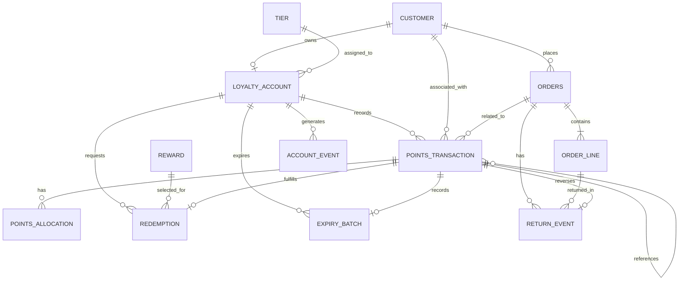

# YottaFlex Loyalty Engine — Data Dictionary

**Document version:** 2.0  
**Database:** SQLite  
**Schema source:** `src/loyalty/db.py`  
**Business logic source:** `src/loyalty/engine.py` and `src/loyalty/generator.py`  
**Dataset seed:** `20261022`

---

## 1. Purpose

This document defines the relational data model used by the YottaFlex Loyalty Engine.

It describes all 13 database tables and their 88 columns, including:

- Column names and SQLite data types.
- Required and optional fields.
- Primary keys and foreign keys.
- Unique constraints and validation rules.
- Entity relationships and cardinality.
- Transaction types and lifecycle statuses.
- Effective-date fields and their validation.
- Points accounting and allocation semantics.
- Order returns, reversals, expiry, and tier history.

The dictionary reflects the implemented SQLite schema. Business rules enforced by application code are identified separately from constraints enforced directly by the database.

## 2. General conventions

### 2.1 Data types

| SQLite type | Meaning |
|---|---|
| `TEXT` | String, identifier, date, timestamp, or categorical value. |
| `INTEGER` | Whole-number value, including monetary amounts in paise, points, quantities, and Boolean-like flags. |

SQLite uses dynamic typing. The types shown below are the declared column types in the schema.

### 2.2 Monetary representation

All monetary amounts are stored as integer paise in INR.

\[
₹1 = 100\text{ paise}
\]

Examples:

| Amount | Stored value |
|---|---:|
| ₹10.00 | 1,000 |
| ₹100.00 | 10,000 |
| ₹500.00 | 50,000 |
| ₹1,000.00 | 100,000 |

No floating-point monetary values are required for the stored transaction amounts.

### 2.3 Dates and timestamps

Dates and timestamps are stored as `TEXT` values.

Recommended representations:

- Date: `YYYY-MM-DD`
- Timestamp: `YYYY-MM-DDTHH:MM:SS`

Examples:

```text
2026-01-15
2026-01-15T12:00:00
```

The database schema does not declare a dedicated DATE or TIMESTAMP type. Application-generated values use ISO-style text representations.

### 2.4 Points representation

Points are stored as integer values.

For `points_transaction`:

- Positive `points_delta`: points credited.
- Negative `points_delta`: points debited.

Examples:

| Transaction type | Typical points delta |
|---|---:|
| ACCRUAL | +500 |
| REDEMPTION | -200 |
| REVERSAL | -100 |
| EXPIRY | -200 |
| ADJUSTMENT | Positive or negative |

The database enforces non-zero `points_delta`, but transaction-type-specific sign rules are primarily application-level business rules.

### 2.5 Key terminology

| Term | Definition |
|---|---|
| PK | Primary key; uniquely identifies a row. |
| FK | Foreign key; references another table. |
| UQ | Unique constraint; prevents duplicate values. |
| NOT NULL | A value is mandatory. |
| CHECK | Database-level validation condition. |
| Nullable | A field may contain `NULL`. |
| BPS | Basis points; 100 bps = 1%. |
| Lot | A group of points originating from an accrual transaction. |
| Ledger | The recorded points transaction history. |
| Idempotency | Repeated processing of the same request does not create duplicate effects. |

---

# 3. Entity inventory

The database contains 13 tables.

| No. | Table | Description |
|---:|---|---|
| 1 | `customer` | Customer master data. |
| 2 | `tier` | Loyalty tier definitions and qualifying-spend thresholds. |
| 3 | `rule` | Loyalty business-rule configuration. |
| 4 | `loyalty_account` | Customer loyalty account and current account status. |
| 5 | `orders` | Customer order headers. |
| 6 | `order_line` | Individual product lines belonging to orders. |
| 7 | `reward` | Reward catalogue. |
| 8 | `points_transaction` | Points ledger containing accruals, redemptions, reversals, expiries, and adjustments. |
| 9 | `points_allocation` | Allocation of redeemed points against accrual lots. |
| 10 | `redemption` | Approved and rejected reward redemption requests. |
| 11 | `expiry_batch` | Records the expiry of an accrual lot. |
| 12 | `account_event` | Account lifecycle and tier-change history. |
| 13 | `return_event` | Partial and full order-line return history. |

---

# 4. Detailed table definitions

## 4.1 Customer — `customer`

**Purpose:** Stores the master profile of each loyalty program customer.

**Primary key:** `customer_id`

| Column | Type | Required | Key / constraint | Description |
|---|---|---|---|---|
| `customer_id` | TEXT | Yes | PK | Unique customer identifier. |
| `full_name` | TEXT | Yes | NOT NULL | Customer display name. |
| `email` | TEXT | Yes | UNIQUE, NOT NULL | Customer email address. |
| `signup_date` | TEXT | Yes | NOT NULL | Date the customer registered. |
| `region` | TEXT | Yes | CHECK | Customer region: NORTH, SOUTH, EAST, or WEST. |
| `created_at` | TEXT | Yes | NOT NULL | Timestamp when the customer record was created. |

**Validation rules:**

- `customer_id` must be unique.
- `email` must be unique.
- All six columns are mandatory.
- `region` must be one of `NORTH`, `SOUTH`, `EAST`, or `WEST`.

**Generated identifier example:**

```text
CUST-000001
```

**Relationships:**

- One customer has one loyalty account.
- One customer can have multiple orders.
- One customer can have multiple points transactions.

---

## 4.2 Tier — `tier`

**Purpose:** Defines loyalty membership tiers, qualifying-spend thresholds, earning rates, and effective dates.

**Primary key:** `tier_id`

| Column | Type | Required | Key / constraint | Description |
|---|---|---|---|---|
| `tier_id` | TEXT | Yes | PK | Unique tier identifier. |
| `tier_name` | TEXT | Yes | UNIQUE, NOT NULL | Human-readable tier name. |
| `min_qualifying_spend_cents` | INTEGER | Yes | CHECK >= 0 | Minimum qualifying spend required for the tier, in paise. |
| `earning_rate_bps` | INTEGER | Yes | CHECK >= 0 | Points earning rate expressed in basis points. |
| `effective_from` | TEXT | Yes | NOT NULL | Date or timestamp when the tier definition becomes effective. |
| `effective_to` | TEXT | No | CHECK | Optional end date or timestamp for the tier definition. |

**Validation rules:**

- `tier_id` must be unique.
- `tier_name` must be unique.
- Qualifying spend cannot be negative.
- Earning rate cannot be negative.
- If `effective_to` is populated, it must be greater than or equal to `effective_from`.

**Generated tier definitions:**

| Tier ID | Tier name | Minimum qualifying spend | Earning rate |
|---|---|---:|---:|
| TIER-BRONZE | Bronze | ₹0 | 100 bps |
| TIER-SILVER | Silver | ₹5,000 | 125 bps |
| TIER-GOLD | Gold | ₹15,000 | 150 bps |
| TIER-PLATINUM | Platinum | ₹30,000 | 200 bps |

**Relationships:**

- One tier can be associated with multiple loyalty accounts.
- Each loyalty account references one current tier.

**Effective-date semantics:**

The database checks that an individual tier record has a valid date interval. It does not enforce non-overlapping effective periods between different tier records. The application must ensure that tier selection is unambiguous when historical or future-dated tier definitions are introduced.

---

## 4.3 Rule — `rule`

**Purpose:** Stores the configurable loyalty program rules used for earning, redemption, expiry, and reversal operations.

**Primary key:** `rule_id`

| Column | Type | Required | Key / constraint | Description |
|---|---|---|---|---|
| `rule_id` | TEXT | Yes | PK | Unique rule identifier. |
| `rule_name` | TEXT | Yes | NOT NULL | Name or description of the rule. |
| `rule_type` | TEXT | Yes | CHECK | Rule category: EARN, REDEEM, EXPIRY, or REVERSAL. |
| `points_per_currency_unit` | INTEGER | Yes | CHECK >= 0 | Configured points-per-currency-unit value. |
| `effective_from` | TEXT | Yes | NOT NULL | Rule start date or timestamp. |
| `effective_to` | TEXT | No | CHECK | Optional rule end date or timestamp. |
| `is_active` | INTEGER | Yes | CHECK IN (0,1) | Indicates whether the rule is active. |

**Validation rules:**

- `rule_id` is unique.
- `rule_type` must be one of:
  - `EARN`
  - `REDEEM`
  - `EXPIRY`
  - `REVERSAL`
- `points_per_currency_unit` must be non-negative.
- `is_active` must be `0` or `1`.
- If `effective_to` is populated, it must be greater than or equal to `effective_from`.

**Generated rule example:**

| Field | Value |
|---|---|
| rule_id | RULE-BASE |
| rule_name | Base earn rule |
| rule_type | EARN |
| points_per_currency_unit | 1 |
| effective_from | 2026-01-01 |
| effective_to | NULL |
| is_active | 1 |

**Important implementation note:**

The table supports four rule categories, but the generated dataset currently inserts one base earning rule. The schema does not define a foreign key from `points_transaction` to `rule`; rule application is therefore not directly traceable through a rule identifier on each transaction.

**Effective-date semantics:**

The database validates each rule's individual date interval. It does not enforce non-overlapping intervals for rules of the same type.

---

## 4.4 Loyalty Account — `loyalty_account`

**Purpose:** Represents the loyalty membership account belonging to a customer.

**Primary key:** `account_id`

**Foreign keys:**

- `customer_id` → `customer.customer_id`
- `tier_id` → `tier.tier_id`

| Column | Type | Required | Key / constraint | Description |
|---|---|---|---|---|
| `account_id` | TEXT | Yes | PK | Unique loyalty account identifier. |
| `customer_id` | TEXT | Yes | FK, UNIQUE | Customer who owns the account. |
| `tier_id` | TEXT | Yes | FK | Current tier associated with the account. |
| `opened_at` | TEXT | Yes | NOT NULL | Account opening timestamp. |
| `status` | TEXT | Yes | CHECK | Current account status: ACTIVE, SUSPENDED, or CLOSED. |

**Validation rules:**

- Every account must reference an existing customer.
- Every account must reference an existing tier.
- A customer can have at most one loyalty account because `customer_id` is unique.
- `status` must be one of:
  - `ACTIVE`
  - `SUSPENDED`
  - `CLOSED`

**Generated identifier example:**

```text
LOY-CUST-000001
```

**Cardinality:**

```text
customer (1) ───────── (0..1) loyalty_account
tier     (1) ───────── (0..N) loyalty_account
```

**Lifecycle semantics:**

The account table stores the current status. Historical status-change events are represented separately in `account_event`.

The database restricts the status to the allowed values but does not enforce a complete transition state machine between ACTIVE, SUSPENDED, and CLOSED.

---

## 4.5 Order — `orders`

**Purpose:** Stores the order header associated with a customer purchase.

**Primary key:** `order_id`

**Foreign key:** `customer_id` → `customer.customer_id`

| Column | Type | Required | Key / constraint | Description |
|---|---|---|---|---|
| `order_id` | TEXT | Yes | PK | Unique order identifier. |
| `customer_id` | TEXT | Yes | FK | Customer who placed the order. |
| `order_date` | TEXT | Yes | NOT NULL | Order date. |
| `currency` | TEXT | Yes | DEFAULT INR, CHECK | Currency code. The implemented schema permits INR only. |
| `gross_amount_cents` | INTEGER | Yes | CHECK >= 0 | Gross order amount before discount, in paise. |
| `discount_cents` | INTEGER | Yes | CHECK >= 0 and <= gross | Discount applied to the order, in paise. |
| `status` | TEXT | Yes | CHECK | Order lifecycle status. |
| `qualifying_spend_cents` | INTEGER | Yes | CHECK >= 0 and <= gross | Spend amount eligible for loyalty tier qualification, in paise. |

**Allowed order statuses:**

| Status | Meaning |
|---|---|
| `COMPLETED` | Order completed without a recorded return. |
| `PARTIALLY_RETURNED` | At least part of the order has been returned. |
| `RETURNED` | Order is recorded as returned. |
| `CANCELLED` | Order is cancelled. |

**Validation rules:**

- Customer reference must exist.
- Currency must be `INR`.
- Gross amount must be non-negative.
- Discount must be non-negative.
- Discount cannot exceed gross amount.
- Qualifying spend must be non-negative.
- Qualifying spend cannot exceed gross amount.
- Status must be one of the four allowed values.

**Generated identifier example:**

```text
ORD-2026-000001
```

**Derived business values:**

A typical initial net eligible amount is:

\[
\text{Net Spend} =
\text{Gross Amount} - \text{Discount}
\]

For returned orders, qualifying spend is reduced by the eligible refund amount.

The schema does not enforce the complete arithmetic relationship between the order header and the sum of its order lines. This is checked by application-level validation.

**Relationships:**

- One customer can have many orders.
- One order can have multiple order lines.
- One order can be referenced by multiple points transactions.
- One order can have multiple return events.

---

## 4.6 Order Line — `order_line`

**Purpose:** Stores individual product or SKU records belonging to an order.

**Primary key:** `order_line_id`

**Foreign key:** `order_id` → `orders.order_id`

| Column | Type | Required | Key / constraint | Description |
|---|---|---|---|---|
| `order_line_id` | TEXT | Yes | PK | Unique order-line identifier. |
| `order_id` | TEXT | Yes | FK | Parent order identifier. |
| `sku` | TEXT | Yes | NOT NULL | Product or stock-keeping-unit identifier. |
| `quantity` | INTEGER | Yes | CHECK > 0 | Original purchased quantity. |
| `unit_price_cents` | INTEGER | Yes | CHECK >= 0 | Stored line amount per quantity unit, in paise. |
| `returned_quantity` | INTEGER | Yes | DEFAULT 0, CHECK | Quantity returned so far. Must be between zero and original quantity. |

**Validation rules:**

- Parent order must exist.
- Quantity must be greater than zero.
- Unit price cannot be negative.
- Returned quantity cannot be negative.
- Returned quantity cannot exceed purchased quantity.

**Generated identifier example:**

```text
LINE-00000001
```

**Relationships:**

- One order can contain multiple order lines.
- One order line can have multiple return events, subject to the remaining returnable quantity.

**Amount semantics:**

The generator splits an order's gross amount across its order lines. The stored `unit_price_cents` is used as the line amount in the generated data; generated line quantities are currently one.

For general multi-quantity data, a line extension amount would conventionally be:

\[
\text{Line Amount} =
\text{Quantity} \times \text{Unit Price}
\]

The current schema does not store a separate line-total column.

---

## 4.7 Reward — `reward`

**Purpose:** Defines the rewards that customers can redeem using loyalty points.

**Primary key:** `reward_id`

| Column | Type | Required | Key / constraint | Description |
|---|---|---|---|---|
| `reward_id` | TEXT | Yes | PK | Unique reward identifier. |
| `reward_name` | TEXT | Yes | NOT NULL | Reward display name. |
| `points_cost` | INTEGER | Yes | CHECK > 0 | Points required to redeem the reward. |
| `is_active` | INTEGER | Yes | CHECK IN (0,1) | Indicates whether the reward is active. |

**Validation rules:**

- Reward identifier must be unique.
- Reward name is mandatory.
- Points cost must be greater than zero.
- `is_active` must be `0` or `1`.

**Generated reward examples:**

| Reward ID | Reward name | Points cost | Active |
|---|---|---:|---:|
| RWD-1000 | Voucher INR 100 | 1,000 | 1 |
| RWD-2500 | Voucher INR 250 | 2,500 | 1 |
| RWD-5000 | Voucher INR 500 | 5,000 | 1 |

**Relationships:**

- One reward can be referenced by multiple redemption requests.
- A redemption must reference an existing reward.

---

## 4.8 Points Transaction — `points_transaction`

**Purpose:** This is the central points ledger. It stores every points-related financial-style movement in an account.

**Primary key:** `transaction_id`

**Foreign keys:**

- `account_id` → `loyalty_account.account_id`
- `customer_id` → `customer.customer_id`
- `order_id` → `orders.order_id` (nullable)
- `reference_transaction_id` → `points_transaction.transaction_id` (nullable)

| Column | Type | Required | Key / constraint | Description |
|---|---|---|---|---|
| `transaction_id` | TEXT | Yes | PK | Unique points transaction identifier. |
| `account_id` | TEXT | Yes | FK | Loyalty account affected by the transaction. |
| `customer_id` | TEXT | Yes | FK | Customer associated with the transaction. |
| `order_id` | TEXT | No | FK | Related order, where applicable. |
| `reference_transaction_id` | TEXT | No | Self-referencing FK | Original transaction associated with a reversal or related transaction. |
| `transaction_type` | TEXT | Yes | CHECK | Type of points transaction. |
| `points_delta` | INTEGER | Yes | CHECK <> 0 | Signed points movement. |
| `lot_id` | TEXT | No | Nullable | Identifier of the accrual lot affected. |
| `created_at` | TEXT | Yes | NOT NULL | Transaction creation timestamp. |
| `expires_at` | TEXT | No | CHECK | Optional expiry timestamp. |
| `idempotency_key` | TEXT | Yes | UNIQUE | Unique key used to prevent duplicate processing. |
| `notes` | TEXT | No | Nullable | Additional transaction description. |

**Allowed transaction types:**

| Type | Purpose | Typical points delta |
|---|---|---:|
| `ACCRUAL` | Points earned from an eligible purchase. | Positive |
| `REDEMPTION` | Points consumed for a reward. | Negative |
| `REVERSAL` | Points removed following a return or correction. | Negative |
| `EXPIRY` | Points removed after expiry. | Negative |
| `ADJUSTMENT` | Manual or system-generated balance correction. | Positive or negative |

**Validation rules:**

- Transaction identifier must be unique.
- Account and customer references must exist.
- Related order must exist when `order_id` is populated.
- Referenced transaction must exist when `reference_transaction_id` is populated.
- Transaction type must be one of the five allowed values.
- Points delta cannot be zero.
- Idempotency key must be unique.
- If `expires_at` is populated, it must not precede `created_at`.

**Generated identifier example:**

```text
PTS-2026-00000001
```

**Generated lot identifier example:**

```text
LOT-ORD-2026-000001
```

**Ledger balance calculation:**

The engine calculates account balance using the sum of points deltas:

\[
\text{Account Balance}
=
\sum \text{points\_delta}
\]

An as-of balance considers only transactions created on or before the supplied timestamp.

**Accrual lot semantics:**

An accrual transaction can establish a points lot. Related reversals and expiry transactions can reference the same lot.

The lot identifier is stored as text. The current schema does not define a separate `points_lot` table or a foreign key on `lot_id`.

**Idempotency examples:**

```text
accrual:<order_id>
redemption:<redemption_id>
return-reversal:<order_id>
```

The engine uses idempotency keys to protect applicable operations against duplicate processing.

---

## 4.9 Points Allocation — `points_allocation`

**Purpose:** Records which accrual lots fund each approved redemption.

This table provides the bridge between a redemption transaction and the accrual lots whose points are consumed.

**Primary key:** `allocation_id`

**Foreign key:** `transaction_id` → `points_transaction.transaction_id`

| Column | Type | Required | Key / constraint | Description |
|---|---|---|---|---|
| `allocation_id` | TEXT | Yes | PK | Unique points allocation identifier. |
| `transaction_id` | TEXT | Yes | FK | Redemption transaction to which the allocation belongs. |
| `lot_id` | TEXT | Yes | NOT NULL | Accrual lot from which points are allocated. |
| `points_allocated` | INTEGER | Yes | CHECK > 0 | Number of points consumed from the lot. |

**Validation rules:**

- Allocation identifier must be unique.
- Referenced transaction must exist.
- Lot identifier is mandatory.
- Allocated points must be greater than zero.

**Generated identifier example:**

```text
ALLOC-RDM-2026-000001-1
```

**Allocation semantics:**

The engine uses FIFO allocation:

1. Find eligible, unexpired accrual lots.
2. Order lots by accrual timestamp and transaction identifier.
3. Determine remaining points in each lot.
4. Allocate redemption points against the oldest eligible lot first.
5. Continue until the requested redemption amount is fully allocated.

**Important schema limitation:**

`lot_id` is not a foreign key because the current schema has no separate points-lot master table. `transaction_id` references the points transaction, but the database does not enforce that it is specifically a redemption transaction. The engine and validator enforce the intended allocation semantics.

---

## 4.10 Redemption — `redemption`

**Purpose:** Records both successful and unsuccessful reward redemption requests.

**Primary key:** `redemption_id`

**Foreign keys:**

- `account_id` → `loyalty_account.account_id`
- `reward_id` → `reward.reward_id`
- `points_transaction_id` → `points_transaction.transaction_id` (nullable and unique)

| Column | Type | Required | Key / constraint | Description |
|---|---|---|---|---|
| `redemption_id` | TEXT | Yes | PK | Unique redemption request identifier. |
| `account_id` | TEXT | Yes | FK | Loyalty account making the request. |
| `reward_id` | TEXT | Yes | FK | Reward requested by the customer. |
| `points_transaction_id` | TEXT | Conditional | UNIQUE, FK | Points ledger transaction for an approved redemption. |
| `requested_points` | INTEGER | Yes | CHECK > 0 | Points requested for redemption. |
| `status` | TEXT | Yes | CHECK | Approval result: APPROVED or REJECTED. |
| `created_at` | TEXT | Yes | NOT NULL | Redemption request timestamp. |
| `rejection_reason` | TEXT | Conditional | Nullable | Reason for rejection. |

**Allowed redemption statuses:**

| Status | Meaning |
|---|---|
| `APPROVED` | Redemption succeeded and has a corresponding points transaction. |
| `REJECTED` | Redemption failed and has no corresponding points transaction. |

**Conditional integrity rules:**

For an approved redemption:

- `points_transaction_id` must be populated.
- `rejection_reason` must be `NULL`.

For a rejected redemption:

- `points_transaction_id` must be `NULL`.
- `rejection_reason` must be populated.

These conditions are enforced through a database CHECK constraint.

**Generated identifier example:**

```text
RDM-2026-000001
```

**Business validation:**

Before approving a redemption, the engine calculates the available points and compares them with the requested amount.

If the available balance is insufficient, the request is recorded as rejected with:

```text
INSUFFICIENT_BALANCE
```

**Relationships:**

- One loyalty account can have multiple redemption attempts.
- One reward can be referenced by multiple redemption attempts.
- An approved redemption has one corresponding points transaction.
- A rejected redemption does not create a points transaction.

---

## 4.11 Expiry Batch — `expiry_batch`

**Purpose:** Records the processing of points expiry against an individual accrual lot.

**Primary key:** `expiry_batch_id`

**Foreign keys:**

- `account_id` → `loyalty_account.account_id`
- `points_transaction_id` → `points_transaction.transaction_id`

| Column | Type | Required | Key / constraint | Description |
|---|---|---|---|---|
| `expiry_batch_id` | TEXT | Yes | PK | Unique expiry batch identifier. |
| `account_id` | TEXT | Yes | FK | Loyalty account whose points expired. |
| `lot_id` | TEXT | Yes | NOT NULL, composite UNIQUE | Accrual lot being expired. |
| `points_transaction_id` | TEXT | Yes | UNIQUE, FK | Expiry transaction recorded in the points ledger. |
| `expired_points` | INTEGER | Yes | CHECK > 0 | Number of points expired. |
| `executed_at` | TEXT | Yes | NOT NULL | Expiry execution timestamp. |

**Validation rules:**

- Account must exist.
- Expiry transaction must exist.
- Each expiry transaction can be referenced by only one expiry batch.
- Expired points must be greater than zero.
- The combination of `account_id` and `lot_id` must be unique.

**Generated identifier example:**

```text
EXP-2026-000001
```

**Idempotency semantics:**

The unique constraint on `(account_id, lot_id)` prevents a second expiry batch for the same account and lot.

The engine also calculates the remaining lot balance before creating an expiry transaction.

---

## 4.12 Account Event — `account_event`

**Purpose:** Stores historical events associated with loyalty accounts, including tier changes and account lifecycle changes.

**Primary key:** `event_id`

**Foreign key:** `account_id` → `loyalty_account.account_id`

| Column | Type | Required | Key / constraint | Description |
|---|---|---|---|---|
| `event_id` | TEXT | Yes | PK | Unique account event identifier. |
| `account_id` | TEXT | Yes | FK | Account associated with the event. |
| `event_type` | TEXT | Yes | CHECK | Type of account event. |
| `old_value` | TEXT | No | Nullable | Previous tier or account value. |
| `new_value` | TEXT | No | Nullable | New tier or account value. |
| `event_at` | TEXT | Yes | NOT NULL | Timestamp when the event occurred. |
| `reason` | TEXT | Yes | NOT NULL | Explanation for the event. |

**Allowed event types:**

| Event type | Meaning |
|---|---|
| `TIER_CHANGED` | Loyalty tier changed. |
| `STATUS_CHANGED` | Account status changed. |
| `ACCOUNT_OPENED` | Account opened. |
| `ACCOUNT_CLOSED` | Account closed. |

**Generated identifier example:**

```text
EVT-TIER-00000001
```

**Example tier-change event:**

| Field | Example |
|---|---|
| event_type | TIER_CHANGED |
| old_value | TIER-BRONZE |
| new_value | TIER-SILVER |
| reason | Qualifying spend reached threshold |
| event_at | 2026-04-15T12:00:00 |

**Lifecycle semantics:**

The table preserves historical event information. It does not independently maintain the current account status or tier; the current tier and status are stored in `loyalty_account`.

The database restricts event types to the four allowed values. It does not enforce all possible state transitions or require old and new values for every event type.

---

## 4.13 Return Event — `return_event`

**Purpose:** Stores append-only records of partial and full order-line returns, including refunds and associated points reversals.

**Primary key:** `return_id`

**Foreign keys:**

- `order_id` → `orders.order_id`
- `order_line_id` → `order_line.order_line_id`
- `reversal_transaction_id` → `points_transaction.transaction_id` (nullable and unique)

| Column | Type | Required | Key / constraint | Description |
|---|---|---|---|---|
| `return_id` | TEXT | Yes | PK | Unique return event identifier. |
| `order_id` | TEXT | Yes | FK | Order associated with the return. |
| `order_line_id` | TEXT | Yes | FK | Specific order line being returned. |
| `returned_quantity` | INTEGER | Yes | CHECK > 0 | Quantity returned in this event. |
| `refund_amount_cents` | INTEGER | Yes | CHECK >= 0 | Refund amount in paise. |
| `reversed_points` | INTEGER | Yes | CHECK >= 0 | Points reversed for the returned items. |
| `reversal_transaction_id` | TEXT | No | UNIQUE, FK | Associated points reversal transaction. |
| `created_at` | TEXT | Yes | NOT NULL | Return event timestamp. |
| `reason` | TEXT | Yes | NOT NULL | Explanation for the return. |

**Validation rules:**

- Return identifier must be unique.
- Order must exist.
- Order line must exist.
- Returned quantity must be greater than zero.
- Refund amount cannot be negative.
- Reversed points cannot be negative.
- Reversal transaction, when populated, must exist.
- A reversal transaction can be linked to only one return event.

**Generated identifier example:**

```text
RET-2026-00000001
```

**Business validation:**

The engine checks that the return quantity does not exceed the remaining returnable quantity.

The return operation:

1. Validates the order line.
2. Calculates the proportional refund.
3. Calculates points to reverse.
4. Records the return event.
5. Creates a reversal transaction when applicable.
6. Updates returned quantity.
7. Updates order status and qualifying spend.

**Order status impact:**

- A returned line in a multi-line order can result in `PARTIALLY_RETURNED`.
- When the only line in an order is returned, the generated scenario can result in `RETURNED`.

The schema itself does not enforce these status transitions. The application logic performs the corresponding updates.

---

# 5. Entity relationships and cardinality

The following relationships are defined through foreign keys and unique constraints.

| Parent entity | Child entity | Relationship | Implementation |
|---|---|---|---|
| Customer | Loyalty account | 1 : 0..1 | Unique FK on `loyalty_account.customer_id` |
| Tier | Loyalty account | 1 : many | FK on `loyalty_account.tier_id` |
| Customer | Orders | 1 : many | FK on `orders.customer_id` |
| Order | Order line | 1 : many | FK on `order_line.order_id` |
| Customer | Points transaction | 1 : many | FK on `points_transaction.customer_id` |
| Loyalty account | Points transaction | 1 : many | FK on `points_transaction.account_id` |
| Order | Points transaction | 1 : 0..many | Nullable FK on `points_transaction.order_id` |
| Points transaction | Points transaction | Self-reference | FK on `reference_transaction_id` |
| Points transaction | Points allocation | 1 : 0..many | FK on `points_allocation.transaction_id` |
| Loyalty account | Redemption | 1 : many | FK on `redemption.account_id` |
| Reward | Redemption | 1 : many | FK on `redemption.reward_id` |
| Points transaction | Redemption | 1 : 0..1 | Unique nullable FK on `redemption.points_transaction_id` |
| Loyalty account | Expiry batch | 1 : many | FK on `expiry_batch.account_id` |
| Points transaction | Expiry batch | 1 : 0..1 | Unique FK on `expiry_batch.points_transaction_id` |
| Loyalty account | Account event | 1 : many | FK on `account_event.account_id` |
| Order | Return event | 1 : many | FK on `return_event.order_id` |
| Order line | Return event | 1 : many | FK on `return_event.order_line_id` |
| Points transaction | Return event | 1 : 0..1 | Unique nullable FK on `return_event.reversal_transaction_id` |

### 5.1 Relationship diagram



**Note:** The diagram describes intended logical relationships. It does not imply additional foreign keys beyond those explicitly declared in the SQLite schema. In particular, `points_allocation.lot_id` has no foreign key to a separate lot table because no such table exists.

---

# 6. Lifecycle and state definitions

## 6.1 Customer lifecycle

The customer table stores customer master information. It does not contain a customer-status column.

Customer registration is represented by the customer record and its signup date.

## 6.2 Loyalty account lifecycle

Allowed account statuses:

```text
ACTIVE
SUSPENDED
CLOSED
```

Account lifecycle event types:

```text
ACCOUNT_OPENED
STATUS_CHANGED
ACCOUNT_CLOSED
```

The current account status is stored in `loyalty_account.status`. Historical events are stored in `account_event`.

The schema validates allowed values but does not implement a complete transition matrix.

## 6.3 Order lifecycle

Allowed order statuses:

```text
COMPLETED
PARTIALLY_RETURNED
RETURNED
CANCELLED
```

The application updates the order status following return processing.

The database does not independently enforce transition ordering between these statuses.

## 6.4 Points transaction lifecycle

A points transaction is a recorded ledger movement.

The implemented transaction types are:

```text
ACCRUAL
REDEMPTION
REVERSAL
EXPIRY
ADJUSTMENT
```

Transactions are represented as signed integer movements.

The engine calculates balances from transaction history instead of treating a separately stored account balance as the authoritative ledger balance.

## 6.5 Redemption lifecycle

Allowed statuses:

```text
APPROVED
REJECTED
```

An approved redemption requires a corresponding points transaction.

A rejected redemption must not reference a points transaction and must contain a rejection reason.

## 6.6 Return lifecycle

A return is represented as a separate `return_event`.

It contains the returned quantity, refund, reversed points, and optional reversal transaction reference.

Multiple return events can exist for the same order line, provided cumulative returned quantity does not exceed the purchased quantity. The engine performs this validation.

## 6.7 Points expiry lifecycle

An expiry operation is recorded in both:

- `points_transaction`, as an `EXPIRY` movement.
- `expiry_batch`, as the lot-level expiry record.

The unique `(account_id, lot_id)` constraint prevents duplicate expiry batches for the same account and lot.

## 6.8 Tier lifecycle

The current tier is stored in `loyalty_account.tier_id`.

Tier history is recorded in `account_event` using:

```text
event_type = TIER_CHANGED
old_value = previous tier identifier
new_value = new tier identifier
```

Tier evaluation is based on qualifying spend. Returns reduce qualifying spend and can lead to tier downgrades.

---

# 7. Effective-date and temporal rules

The `tier` and `rule` tables contain:

```text
effective_from
effective_to
```

### 7.1 Implemented database constraints

For both tables:

- `effective_from` is mandatory.
- `effective_to` is optional.
- If `effective_to` is populated, it must be greater than or equal to `effective_from`.

### 7.2 Effective-date limitations

The current schema does not include:

- An exclusion constraint preventing overlapping tier periods.
- An exclusion constraint preventing overlapping rule periods.
- A trigger enforcing a single active tier definition for a particular effective timestamp.
- A trigger preventing multiple active rules of the same type.

These conditions must be handled by application-level validation if multiple historical or future-dated versions are introduced.

### 7.3 Current generated configuration

The generator inserts the four tier definitions with:

```text
effective_from = 2026-01-01
effective_to   = NULL
```

The base earning rule uses the same effective start date and an open-ended end date.

---

# 8. Points accounting and derived values

## 8.1 Account balance

The authoritative balance is calculated from the ledger:

\[
B_a(t)=\sum_{i \in T_a,\;created_i \leq t} points\_delta_i
\]

Where:

- \(B_a(t)\) is the account balance at time \(t\).
- \(T_a\) is the set of transactions belonging to account \(a\).
- `points_delta` is the signed transaction movement.

## 8.2 Accrual calculation

The generator calculates points using net eligible spend and the tier earning rate.

\[
Points =
\left\lfloor
\frac{NetSpend_{\text{paise}}\times EarningRate_{\text{bps}}}
{10000}
\right\rfloor
\]

For example, with ₹1,000 net spend and 100 bps:

\[
\frac{100000\times100}{10000}=1000
\]

The result is 1,000 points under the implemented earning formula.

## 8.3 Qualifying spend

Qualifying spend is the amount used for tier progression.

A typical calculation is:

\[
QualifyingSpend =
EligibleSpend - EligibleRefunds
\]

Gross order value should not be substituted for qualifying spend when determining tier eligibility.

## 8.4 Redemption allocation

The engine consumes eligible accrual lots using FIFO order.

A redemption can therefore be funded by multiple accrual lots.

The total allocated points should reconcile to the redemption transaction amount:

\[
\sum PointsAllocated =
|RedemptionPointsDelta|
\]

## 8.5 Points reversal

A reversal references the original accrual through `reference_transaction_id`.

The engine prevents reversal beyond the original accrual's remaining unreversed points and checks whether points have already been consumed or expired.

## 8.6 Expiry

Expiry is applied to the remaining eligible points in an accrual lot.

An expired lot cannot be processed again for the same account because of the unique expiry-batch constraint.

---

# 9. Database constraints and application-level validation

It is important to distinguish SQL-enforced constraints from rules enforced by Python.

| Validation | Database enforced | Application / validator enforced |
|---|---|---|
| Primary-key uniqueness | Yes | Additional validation |
| Customer email uniqueness | Yes | Additional validation |
| One account per customer | Yes | Additional validation |
| Foreign-key existence | Yes | Additional validation |
| Allowed customer regions | Yes | Additional validation |
| Allowed tier and rule values | Partially | Additional validation |
| Valid effective-date interval | Yes | Additional overlap checks required |
| No overlapping effective periods | No | Not currently enforced by schema |
| Non-negative monetary amounts | Yes | Additional arithmetic checks |
| Order gross and discount relationship | Yes | Additional order validation |
| Order-line returned quantity bounds | Yes | Return processing checks |
| Points transaction type enumeration | Yes | Additional transaction semantics |
| Non-zero points movement | Yes | Additional transaction semantics |
| Unique idempotency key | Yes | Engine-level idempotency handling |
| Redemption approval consistency | Yes | Engine and validator |
| FIFO allocation correctness | No | Engine and validator |
| Allocation lot existence | No | Application-level validation |
| Allocation total equals redemption | No | Validator |
| Reversal does not exceed accrual | No | Engine and validator |
| Return quantity does not exceed purchased quantity | Partially | Engine and validator |
| Refund and reversal arithmetic | No | Engine and validator |
| Duplicate expiry prevention | Yes | Engine and validator |
| Qualifying spend consistency | No | Generator and validator |
| Tier transition correctness | No | Generator and validator |

---

# 10. Indexes

The schema defines indexes to improve lookup and filtering operations.

| Index | Table | Indexed columns |
|---|---|---|
| `idx_customer_email` | customer | `email` |
| `idx_orders_customer` | orders | `customer_id` |
| `idx_orders_date` | orders | `order_date` |
| `idx_order_line_order` | order_line | `order_id` |
| `idx_account_customer` | loyalty_account | `customer_id` |
| `idx_account_tier` | loyalty_account | `tier_id` |
| `idx_points_account` | points_transaction | `account_id` |
| `idx_points_customer` | points_transaction | `customer_id` |
| `idx_points_order` | points_transaction | `order_id` |
| `idx_points_type` | points_transaction | `transaction_type` |
| `idx_points_reference` | points_transaction | `reference_transaction_id` |
| `idx_points_lot_expiry` | points_transaction | `account_id`, `lot_id`, `expires_at` |
| `idx_points_allocation_lot` | points_allocation | `lot_id` |
| `idx_redemption_account` | redemption | `account_id` |
| `idx_expiry_account` | expiry_batch | `account_id` |
| `idx_account_event_account` | account_event | `account_id`, `event_at` |
| `idx_return_order` | return_event | `order_id` |
| `idx_return_line` | return_event | `order_line_id` |

Some indexes overlap with unique constraints, which also create supporting indexes in SQLite.

---

# 11. Identifier conventions

The generator uses structured identifiers for its principal entities.

| Entity | Format | Example |
|---|---|---|
| Customer | `CUST-` + six digits | `CUST-000001` |
| Loyalty account | `LOY-` + customer ID | `LOY-CUST-000001` |
| Tier | `TIER-<NAME>` | `TIER-BRONZE` |
| Rule | `RULE-<NAME>` | `RULE-BASE` |
| Order | `ORD-2026-` + six digits | `ORD-2026-000001` |
| Order line | `LINE-` + eight digits | `LINE-00000001` |
| Points transaction | `PTS-2026-` + eight digits | `PTS-2026-00000001` |
| Points lot | `LOT-` + order ID | `LOT-ORD-2026-000001` |
| Redemption | `RDM-2026-` + six digits | `RDM-2026-000001` |
| Reward | `RWD-` + points denomination | `RWD-1000` |
| Expiry batch | `EXP-2026-` + six digits | `EXP-2026-000001` |
| Account event | `EVT-TIER-` + eight digits | `EVT-TIER-00000001` |
| Return event | `RET-2026-` + eight digits | `RET-2026-00000001` |
| Points allocation | `ALLOC-` + redemption ID + sequence | `ALLOC-RDM-2026-000001-1` |

These are generator conventions. The database primarily enforces uniqueness and does not use CHECK constraints to validate every identifier's textual format.

---

# 12. Generated dataset profile

The verified Phase 4 generation produced the following record counts.

| Table | Generated rows |
|---|---:|
| `customer` | 20,000 |
| `loyalty_account` | 20,000 |
| `tier` | 4 |
| `rule` | 1 |
| `orders` | 100,000 |
| `order_line` | 250,319 |
| `reward` | 3 |
| `points_transaction` | 317,987 |
| `points_allocation` | 120,265 |
| `redemption` | 138,522 |
| `expiry_batch` | 97,486 |
| `account_event` | 31,484 |
| `return_event` | 2,079 |

**Total:** 13 relational tables.

These figures describe the verified generated dataset using seed `20261022`. They are not fixed schema limits.

---

# 13. Data quality and integrity expectations

The generated database is expected to satisfy the following checks:

1. Every primary key is unique.
2. Every populated foreign-key reference resolves to an existing parent record.
3. Customer emails are unique.
4. Loyalty accounts do not duplicate a customer.
5. Order amounts and discounts satisfy their constraints.
6. Order-line quantities and returned quantities remain valid.
7. Points transaction types use the permitted enumeration.
8. Points transaction identifiers and idempotency keys are unique.
9. Approved redemption records have matching points transactions.
10. Rejected redemption records have no points transaction and contain a rejection reason.
11. Points allocations reconcile with redemption movements.
12. Reversals reference valid original accrual transactions.
13. Reversals do not exceed the original accrual.
14. Expiry batches do not duplicate account/lot combinations.
15. Returned quantities do not exceed purchased quantities.
16. Return records reference valid orders and order lines.
17. Refunds and points reversals reconcile with return processing.
18. Qualifying spend reflects eligible returns.
19. Tier transitions are consistent with qualifying spend.
20. SQLite integrity and foreign-key checks pass.

The Python validation module performs additional checks that are not expressible as ordinary table-level constraints.

---

# 14. Known schema limitations and future improvements

The following are documented limitations of the current implementation, not claims that the database already supports these capabilities.

| Area | Current implementation | Potential enhancement |
|---|---|---|
| Points lot master | Lot represented by `lot_id` on transactions | Introduce a dedicated `points_lot` table. |
| Rule-to-transaction traceability | No `rule_id` on points transactions | Add `rule_id` FK to transaction records. |
| Allocation integrity | Allocation references transaction; lot is text | Add a formal lot entity and enforce its FK. |
| Effective-date overlap | Individual intervals validated | Add application-level overlap checks or triggers. |
| Tier history | Stored as account events | Add effective-dated account-tier history table if full historical querying is required. |
| Account status transitions | Allowed values enforced | Add a formal lifecycle transition policy. |
| Currency | INR only | Add multi-currency support if required. |
| Concurrency | SQLite transaction handling | Test concurrent workers and consider PostgreSQL for production-scale contention. |
| Auditability | Explicit transaction and event history | Add actor/source metadata and immutable audit controls. |
| Rule versioning | Basic effective dates | Add rule versions and transaction-level rule references. |

---

# 15. Source of truth

The database schema is the authoritative source for table names, column names, declared data types, nullability, primary keys, foreign keys, unique constraints, and CHECK constraints.

The implementation references are:

| File | Responsibility |
|---|---|
| `src/loyalty/db.py` | SQLite schema, indexes, connection setup, and database integrity helpers. |
| `src/loyalty/engine.py` | Points balance, accrual, redemption, FIFO allocation, reversal, returns, and expiry operations. |
| `src/loyalty/generator.py` | Deterministic master data, order generation, tier progression, returns, redemptions, and expiry data. |
| `src/loyalty/validate.py` | Data-quality and business-rule validation. |
| `tests/test_engine.py` | Automated engine behavior tests. |

This document describes the implemented schema and distinguishes database-enforced constraints from application-level behavior.

**End of Data Dictionary**